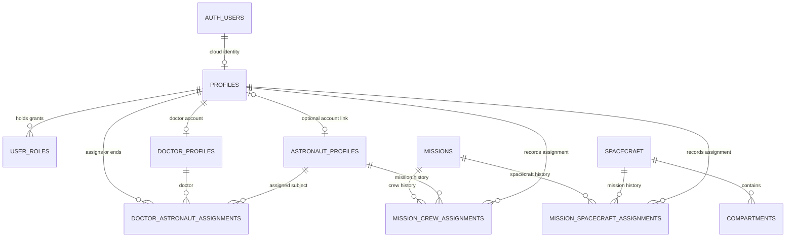
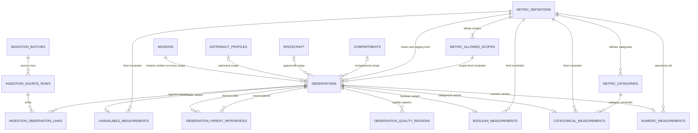
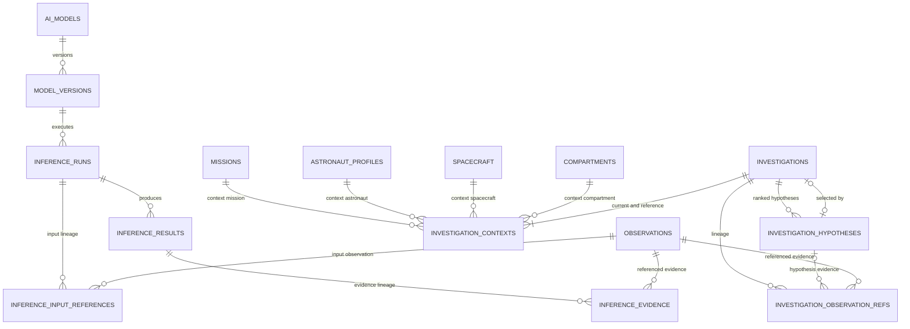
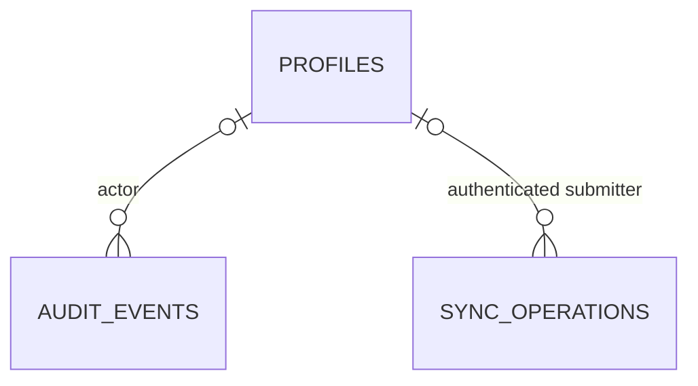

# CAREYONDA Database ERD — Design Proposal

**Status:** Milestone 2 design proposal; not an implemented schema.
**Basis:** Milestone 1 repository audit and the current source contracts.
**Scope:** PostgreSQL as the primary relational store; Supabase services are an
optional cloud adapter. No migrations, policies, or runtime integrations are
created by this document.

The codebase does not currently implement this schema or durable observation
persistence. “Required” below means required by this proposed normalized model
if the corresponding persistence use case is approved; it is not a claim that
the feature is implemented or approved for production.

## 1. Architecture overview

This design separates Auth identities, application roles, astronaut/doctor
subjects, mission assignments, source observations, and derived research outputs.
It preserves CAREYONDA's offline-first direction: local ingestion, validation,
reasoning, and review remain usable without Supabase. Cloud synchronization is
an explicit, optional boundary and is not required for local operation.
“PostgreSQL as primary” here means the proposed server/cloud relational store,
not the sole durable store: offline writes require a separately approved local
store and synchronization design. The repository currently has no durable local
observation database or synchronization protocol.

The observation design is one shared `observations` identity/metadata table for
all domains and scopes. Its measurement union is represented by four subtype
tables (numeric, boolean, categorical, unavailable), each with an observation
foreign key. This avoids separate health/environment tables and avoids stuffing
a discriminated union into unconstrained JSON. A deferred constraint trigger is
needed to require exactly one subtype row matching the declared
`measurement_kind` at transaction commit. The contract validator remains the
input boundary; database constraints provide an independent integrity layer.

Observation IDs in v1 are strings, not UUIDs. The proposed `record_id` UUID is a
stable relational identity for foreign-key references. Client generation and
reuse across offline devices are proposals, not existing behavior; cross-device
collision and ownership rules are unresolved. `observation_id` is preserved
verbatim from the source contract. A scoped uniqueness constraint is only a
candidate: uniqueness across producers and repeated imports is not established.

All JSONB payloads below are immutable, versioned contract snapshots for
retrieval/audit, not replacements for relational foreign keys. A normalized
reference row must exist for every persisted AI observation reference. Full
contract validation and consistency checks remain application responsibilities
where PostgreSQL cannot express the rule declaratively.

## 2. ER diagrams

The diagrams show proposed tables and foreign keys. `auth.users` is Supabase's
external Auth table, not a CAREYONDA-owned table. Optional tables are marked
`(optional)` in the entity descriptions and data dictionary.

### Identity, roles, missions, and locations

### Metrics and observations

**Verified scope contract:** each of the four discriminated variants contains a
required `mission_id`. That FK is mission context on every observation, not the
scope identity itself. `scope_kind` identifies the distinct scope: astronaut
requires `astronaut_id`; spacecraft requires `spacecraft_id`; compartment
requires both `spacecraft_id` and `compartment_id`; mission requires none of
those three columns. A row-level check rejects irrelevant non-NULL scope
columns. The compartment FK includes `spacecraft_id`, preventing a compartment
from being attached to a different spacecraft. These FKs do not prove that the
subject or spacecraft was assigned to the mission at `event_at`; that temporal
relationship needs separate trusted validation.

### AI outputs and M2 investigations

M2 is a deterministic research investigation, not one of the model inference
runs. No `inference_run_id` is added to an investigation without an actual
producer/consumer relationship in the code. Model A and Model C outputs remain
separate versioned inference results; no Model B schema or output fields are
proposed.

### Operations and optional sync

`sync_operations` is an idempotency receipt ledger, not a polymorphic foreign-key
to business rows. The offline outbox and local identity store are outside this
cloud ERD and remain to be designed against an approved local-storage choice.

## 3. Entity descriptions and inclusion decisions

`Required` means needed to represent the proposed identity/access requirements
or verified observation contract if database storage is adopted. `Optional`
means supported by current contracts or requested architecture but not currently
persisted or required by an implemented workflow.

### Identity and access

- **profiles (required for cloud Auth):** CAREYONDA account status linked to a
  Supabase Auth UUID. Suspend rather than delete accounts by default.
- **user_roles (required):** appendable/revocable Admin, Doctor, and Astronaut
  grants. One profile can have multiple roles. Grant changes are administrator
  operations, enforced by FastAPI.
- **astronaut_profiles (required for astronaut-scoped access):** domain
  `astronaut_id` and optional account link. Synthetic/research subjects may have
  no account link.
- **doctor_profiles (required for doctor assignment):** domain doctor ID mapped
  to a profile.
- **doctor_astronaut_assignments (required for the approved access rule):**
  effective-dated assignment history; an ended row is retained.

No separate `roles` table is proposed: the three approved role identifiers are a
closed application enum. Do not copy email or other Auth PII into this schema
unless a separate product requirement justifies it.

### Missions and locations

- **missions (required):** stable mission identifier used in all observation
  scopes.
- **spacecraft (required):** stable spacecraft identifier from the observation
  scope.
- **compartments (required):** compartment identifier scoped to its spacecraft.
- **mission_crew_assignments (required for historical mission access):** effective
  participation periods, rather than a mutable current-crew flag.
- **mission_spacecraft_assignments (required for historical mission/location
  context):** effective mission/spacecraft periods.

Mission phases are excluded: no current observation, API, or workflow contract
uses them. Additional mission names, status, launch dates, and crew job titles
are not verified fields.

### Observation and ingestion

- **metric_definitions, metric_allowed_scopes, metric_categories (required):**
  proposed normalized mirror of the current metric registry. The registry calls
  its expected type `measurement_kind`; the database calls it `metric_kind` to
  distinguish that expected type from the actual observation union variant in
  `measurement_kind`. The verified registry values are listed in
  [DATA_DICTIONARY.md](./DATA_DICTIONARY.md) and must not be invented.
- **observations (required):** shared, source-preserving observation identity,
  time, scope, quality status, provenance, and optional simulation metadata.
- **numeric_measurements, boolean_measurements, categorical_measurements,
  unavailable_measurements (required):** the four Observation v1 tagged-union
  variants. Exactly one matching child is required per observation.
- **observation_quality_reasons (required):** zero reason rows for valid data;
  at least one for non-valid data.
- **observation_parent_references (required):** real self-FKs for derived
  observations; no free-form parent IDs.
- **ingestion_batches, ingestion_source_rows, ingestion_observation_links
  (optional):** represent the NASA adapter's file hash, source row number,
  original field tokens, time interpretation, issue codes, and row-to-observation
  mapping. Only create them if ingestion artifacts are approved for persistence.

An `observation_sources` table and `devices` table are not proposed. The contract
has source type, source ID, method, and origin, but no verified source registry
or stable device lifecycle. `sensor_id`/`sensor_epoch` exist in research
contracts as caller declarations; they do not prove an actual hardware inventory.

Numeric contracts require the registry's exact canonical unit; the contract
validator does not convert units. Any approved source-unit conversion belongs
in a source-specific ingestion adapter before contract validation, must be
explicitly mapped/versioned, and must preserve the raw source token when that
retention is approved. Unknown unit mappings should be rejected or quarantined,
not guessed. The quality evaluator compares finite numeric values with registry
physical bounds and reports `physical_domain_violation` as invalid without
discarding the observation. The current schema proposal does not yet distinguish
the incoming `DataQuality` from that derived evaluation in persistence; resolve
whether to recompute it or persist a separate versioned assessment before DDL.

### AI and research

- **ai_models, model_versions, inference_runs, inference_input_references,
  inference_results, inference_evidence (optional):** candidate for durable model
  runs and outputs. Persist full versioned payloads and separate validated
  observation references.
- **investigations, investigation_contexts, investigation_hypotheses,
  investigation_observation_refs (optional):** candidate for durable M2 output
  retrieval and lineage. M2 is not persisted today.

Model A has an implemented inference contract and local artifact metadata.
Model C has an implemented transient assessment contract. Neither implies a
deployed model or approved persistent-result workflow. Model B remains excluded
until its actual contract and implementation exist. Research experiment and
evaluation tables are excluded: simulator exports exist, but no actual training
pipeline or evaluation-output contract was found.

### Operations

- **audit_events (optional, recommended before sensitive multi-user
  deployment):** append-only security/account-operation events. Do not store
  medical values, tokens, or request bodies.
- **sync_operations (optional):** cloud idempotency receipts for retried offline
  sync operations. The local outbox itself is not specified here.

### Explicitly excluded

No `medical_notes`, `medical_reviews`, `medical_note_amendments`, `alerts`,
`alert_events`, `recommendations`, mission phases, device inventory, Model B
results, or clinical/safety-policy tables are proposed. The frontend incidents
are synthetic review exercises with session-only notes/status; safety and
procedure implementations are empty. These entities require separately approved
product contracts and safety/governance decisions.

## 4. Relationship matrix

`CASCADE` below means deletion of the child/association record only when its
parent is intentionally removed. Because observations and derived results are
evidence records, their referenced data should normally use `RESTRICT`; accounts
and assignments should be suspended/ended rather than hard-deleted. All PK
identifiers are immutable. Updating a parent key is prohibited; use `ON UPDATE
RESTRICT`.

| Parent | Child | Foreign key | Cardinality | Optional? | Delete behavior / historical rule |
|---|---|---|---|---|---|
| `auth.users` (external) | `profiles` | `profiles.id` | 1:0..1 | Profile exists only for app account | `RESTRICT`; suspend profile, do not cascade-delete audit/history |
| `profiles` | `user_roles` | `user_roles.user_id` | 1:M | No | `RESTRICT`; revoke grant by `revoked_at` |
| `profiles` | `user_roles` | `user_roles.assigned_by_user_id` | 1:M | No | `RESTRICT`; retain grant actor |
| `profiles` | `astronaut_profiles` | `astronaut_profiles.user_id` | 1:0..1 | Yes | `SET NULL` only after approved unlink; astronaut subject remains |
| `profiles` | `doctor_profiles` | `doctor_profiles.user_id` | 1:0..1 | No for doctor account | `RESTRICT`; suspend/unassign instead |
| `doctor_profiles` | `doctor_astronaut_assignments` | `doctor_id` | 1:M | No | `RESTRICT`; end assignment |
| `astronaut_profiles` | `doctor_astronaut_assignments` | `astronaut_id` | 1:M | No | `RESTRICT`; end assignment |
| `profiles` | `doctor_astronaut_assignments` | `assigned_by_user_id` | 1:M | No | `RESTRICT`; retain assigning actor |
| `profiles` | `doctor_astronaut_assignments` | `ended_by_user_id` | 1:M | Yes | `RESTRICT`; nullable until ended |
| `missions` | `mission_crew_assignments` | `mission_id` | 1:M | No | `RESTRICT`; retain closed mission |
| `astronaut_profiles` | `mission_crew_assignments` | `astronaut_id` | 1:M | No | `RESTRICT`; end assignment |
| `profiles` | `mission_crew_assignments` | `assigned_by_user_id` | 1:M | No | `RESTRICT`; retain actor |
| `missions` | `mission_spacecraft_assignments` | `mission_id` | 1:M | No | `RESTRICT`; retain history |
| `spacecraft` | `mission_spacecraft_assignments` | `spacecraft_id` | 1:M | No | `RESTRICT`; retain history |
| `profiles` | `mission_spacecraft_assignments` | `assigned_by_user_id` | 1:M | No | `RESTRICT`; retain actor |
| `spacecraft` | `compartments` | `spacecraft_id` | 1:M | No | `RESTRICT`; composite PK scopes compartment ID |
| `metric_definitions` | `metric_allowed_scopes` | `metric_id` | 1:M | No | `RESTRICT`; registry changes are versioned, not destructive |
| `metric_definitions` | `metric_categories` | `(metric_id, metric_kind)` | 1:M | No | `RESTRICT`; child fixes `metric_kind` to `categorical` |
| `missions` | `observations` | `mission_id` | 1:M | No | `RESTRICT`; no cascade on evidence |
| `astronaut_profiles` | `observations` | `astronaut_id` | 1:M | Yes, scope-dependent | `RESTRICT`; subject row retained |
| `spacecraft` | `observations` | `spacecraft_id` | 1:M | Yes, scope-dependent | `RESTRICT`; spacecraft row retained |
| `compartments` | `observations` | `(spacecraft_id, compartment_id)` | 1:M | Yes, compartment scope only | `RESTRICT`; composite FK |
| `metric_definitions` | `observations` | `(metric_id, domain, metric_kind)` | 1:M | No | `RESTRICT`; validates domain/kind vocabulary |
| `metric_allowed_scopes` | `observations` | `(metric_id, scope_kind)` | 1:M | No | `RESTRICT`; validates scope-kind combination |
| `observations` | `numeric_measurements` | `(record_id, metric_id, metric_kind, measurement_kind)` | 1:0..1 | Actual variant is not numeric | Deferred check requires matching subtype; cascade child with parent |
| `observations` | `boolean_measurements` | `(record_id, metric_id, metric_kind, measurement_kind)` | 1:0..1 | Actual variant is not boolean | Deferred check; cascade child with parent |
| `observations` | `categorical_measurements` | `(record_id, metric_id, metric_kind, measurement_kind)` | 1:0..1 | Actual variant is not categorical | Deferred check; cascade child with parent |
| `observations` | `unavailable_measurements` | `(record_id, metric_id, metric_kind, measurement_kind)` | 1:0..1 | Actual variant is available | Deferred check; cascade child with parent |
| `metric_definitions` | `numeric_measurements` | child `(metric_id, metric_kind, unit)` → `(metric_id, metric_kind, canonical_unit)` | 1:M | No | `RESTRICT`; enforces canonical unit |
| `metric_definitions` | `boolean_measurements` | `(metric_id, metric_kind)` | 1:M | No | `RESTRICT` |
| `metric_definitions` | `categorical_measurements` | `(metric_id, metric_kind)` | 1:M | No | `RESTRICT` |
| `metric_categories` | `categorical_measurements` | `(metric_id, category)` | 1:M | No | `RESTRICT`; prevents unsupported category |
| `metric_definitions` | `unavailable_measurements` | `(metric_id, metric_kind)` | 1:M | No | `RESTRICT`; absence valid for any supported metric kind |
| `observations` | `observation_quality_reasons` | `record_id` | 1:M | Yes only when valid (zero rows) | `CASCADE` with observation |
| `observations` | `observation_parent_references` | `child_record_id` | 1:M | Yes except derived records | `RESTRICT`; preserve derived lineage |
| `observations` | `observation_parent_references` | `parent_record_id` | 1:M | Yes | `RESTRICT`; referenced parent cannot be deleted |
| `ingestion_batches` | `ingestion_source_rows` | `batch_id` | 1:M | Batch may have zero rows | `RESTRICT` after accepted batch; retention policy TBD |
| `ingestion_source_rows` | `ingestion_observation_links` | `(batch_id, row_number)` | 1:M | Source row may emit zero or multiple records | `RESTRICT`; preserve row audit |
| `observations` | `ingestion_observation_links` | `record_id` | 1:M | Observation may not be batch-ingested | `RESTRICT` |
| `ai_models` | `model_versions` | `model_id` | 1:M | Model may have no registered versions | `RESTRICT`; versions immutable |
| `model_versions` | `inference_runs` | `model_version_id` | 1:M | Version may not yet be run | `RESTRICT`; preserve version lineage |
| `inference_runs` | `inference_input_references` | `run_id` | 1:M | Failed/empty runs may have none | `CASCADE` only as part of approved run purge |
| `observations` | `inference_input_references` | `record_id` | 1:M | Observation may never be model input | `RESTRICT` |
| `inference_runs` | `inference_results` | `run_id` | 1:M | Failed or abstained run may have none | `RESTRICT`; retain run/results together |
| `inference_results` | `inference_evidence` | `result_id` | 1:M | Result may have no evidence references | `CASCADE` only with result |
| `observations` | `inference_evidence` | `record_id` | 1:M | Observation may not support a result | `RESTRICT` |
| `investigations` | `investigation_contexts` | `investigation_id` | 1:2 | Exactly current and reference contexts | `RESTRICT`; immutable context snapshots |
| `missions` | `investigation_contexts` | `mission_id` | 1:M | No | `RESTRICT` |
| `astronaut_profiles` | `investigation_contexts` | `astronaut_id` | 1:M | No | `RESTRICT` |
| `spacecraft` | `investigation_contexts` | `spacecraft_id` | 1:M | No | `RESTRICT` |
| `compartments` | `investigation_contexts` | `(spacecraft_id, compartment_id)` | 1:M | No | `RESTRICT` |
| `investigations` | `investigation_hypotheses` | `investigation_id` | 1:M | Result contract permits zero hypotheses structurally; verify producer rules | `RESTRICT`; preserve returned ranking |
| `investigation_hypotheses` | `investigations` (selected hypothesis) | `(investigation_id, selected_hypothesis)` | 0..1:0..1 | Yes when no selection | `RESTRICT`; deferred FK to same investigation's `(investigation_id, hypothesis_id)` |
| `investigations` | `investigation_observation_refs` | `investigation_id` | 1:M | Yes for no-evidence output | `RESTRICT` |
| `investigation_hypotheses` | `investigation_observation_refs` | `(investigation_id, hypothesis_id)` | 1:M | Yes for whole-window input refs | Nullable hypothesis FK |
| `observations` | `investigation_observation_refs` | `record_id` | 1:M | Observation may not be used by investigation | `RESTRICT` |
| `profiles` | `audit_events` | `actor_user_id` | 1:M | Yes for system-originated event | `RESTRICT` for known actor; retain history |
| `profiles` | `sync_operations` | `submitted_by_user_id` | 1:M | Yes until server authenticates sync | `RESTRICT`; not derived from install ID |

### Many-to-many relationships

The following relationships use junction/association entities rather than array
columns or polymorphic business-record references:

1. Profiles ↔ roles through `user_roles` (with grant/revocation history).
2. Doctors ↔ astronauts through `doctor_astronaut_assignments`.
3. Missions ↔ astronauts through `mission_crew_assignments`.
4. Missions ↔ spacecraft through `mission_spacecraft_assignments`.
5. Metrics ↔ scope kinds through `metric_allowed_scopes`.
6. Metrics ↔ categorical values through `metric_categories`.
7. Derived observations ↔ parent observations through
   `observation_parent_references`.
8. Inference runs ↔ input observations through `inference_input_references`.
9. Inference results ↔ evidence observations through `inference_evidence`.
10. Investigations ↔ hypothesis evidence observations through
    `investigation_observation_refs`.
11. Ingestion source rows ↔ observations through
    `ingestion_observation_links`.

No unconstrained polymorphic FK is used for model evidence. `sync_operations`
contains only operation receipts and does not claim an FK to an arbitrary
business entity.

## 5. Referential-integrity rules

1. **Observation scope:** `mission_id` is always present. A CHECK enforces exactly
   the scope columns for `scope_kind`: astronaut requires only `astronaut_id`;
   spacecraft requires only `spacecraft_id`; compartment requires spacecraft
   plus compartment; mission requires none of those three. Real FKs validate all
   populated identifiers. The mission FK is context independent of scope
   identity. The compartment FK includes `spacecraft_id`.
2. **Scope/metric compatibility:** `(metric_id, scope_kind)` references
   `metric_allowed_scopes`; `(metric_id, domain, metric_kind)` references a
   unique metric definition. `metric_kind` is the registry's expected type;
   the actual observation variant is stored separately.
   `metric_categories` also references `(metric_id, metric_kind)` and fixes the
   kind to `categorical`, preventing categories for numeric or boolean metrics.
3. **Measurement union:** `metric_kind` is the registry's expected type
   (`numeric`, `boolean`, or `categorical`); `measurement_kind` is the actual
   Observation v1 tagged-union variant and can additionally be `unavailable`.
   Subtype tables carry fixed variant checks, FKs to the parent observation and
   metric definition, and unit/category FKs where applicable. A deferred
   constraint trigger requires exactly one child subtype and a matching
   `measurement_kind`. The unavailable subtype may accompany any supported
   `metric_kind`. Numeric values must be finite; absence is never zero.
   Source-specific conversion is not a database responsibility; unknown units
   are rejected, not inferred. Registry physical bounds are assessed by the
   application quality evaluator, which reports invalidity without discarding
   evidence. The proposal does not yet model that derived assessment separately
   from input `DataQuality`.
4. **Quality:** a deferred trigger enforces the input contract's zero
   quality-reason rows for `valid`, one or more for other statuses, and no
   `sensor_confidence` for `missing`/`unavailable`. Do not overwrite that input
   quality with a separate physical-domain evaluation; decide how derived
   evaluation results are persisted before DDL.
5. **Provenance:** checks enforce allowed source type/origin pairs, simulation
   metadata present only for simulated records, and transformation metadata for
   derived records. A deferred trigger verifies derived records have parent rows
   and non-derived rows do not. Parent rows have real self-FKs and cannot point
   to themselves. Application validation also rejects duplicate parents. The
   contract permits multiple parents; whether longer dependency cycles must be
   rejected remains unresolved.
6. **Time:** PostgreSQL `timestamptz` stores instants; APIs must require aware
   timestamps and preserve event time separately from ingestion/assessment time.
   `ingested_at >= event_at` follows Observation v1. Mission/assignment temporal
   membership requires transaction-time validation or a trigger; plain FKs do
   not prove that an assignment was active at event time.
7. **AI lineage:** all inference and investigation references resolve to the
   observation `record_id` via FKs. During result persistence, the backend
   resolves every contract `observation_id`; missing or ambiguous IDs reject
   persistence. The original IDs and complete versioned result remain in the
   payload snapshot.
   The proposed deferred FK from a selected hypothesis to the same
   investigation's hypothesis key enforces membership when the selection is
   non-null. The producer's status/selection invariant must also be validated;
   the Pydantic output schema does not enforce it.
8. **No cycles in dependencies:** model runs refer to versions, and results
   refer to runs. M2 investigations are separate. No run points back to an
   investigation and no investigation points to a run, so there is no circular
   FK. Whether derived-observation parent graphs must be acyclic is an additional
   integrity policy to decide; v1 prohibits self-reference, not longer cycles.

## 6. Historical assignments

`doctor_astronaut_assignments`, `mission_crew_assignments`, and
`mission_spacecraft_assignments` are append/end records with `starts_at` and
nullable `ended_at`. `ended_at IS NULL` means active. Ending an assignment sets
the end timestamp and ending actor where applicable; it never deletes or
overwrites the prior interval. A partial unique index prevents duplicate active
doctor/astronaut pairs and duplicate active mission/astronaut or
mission/spacecraft pairs. A CHECK requires `ended_at > starts_at`. Whether
overlapping but non-identical historical intervals must be prohibited should be
approved and enforced with a transaction/trigger or a supported exclusion
constraint.

For any access to a historical observation, the backend must check that the
subject's mission/doctor assignment was effective at the relevant time. RLS
alone cannot reliably represent the full time-qualified policy without a
trusted database function and clearly defined “current versus historical”
access policy.

The doctor-assignment schema records both assigning and ending actors. The
mission-crew and mission-spacecraft schemas currently record the assigning actor
but not the actor who ends an interval. Decide whether those closure actors need
dedicated FKs or are adequately represented by a separately approved audit
event; do not imply that the current columns provide both.

## 7. Design decisions and trade-offs

- **One observation identity table:** common time, scope, quality, provenance,
  and lineage are shared by all metrics. Typed measurement subtables preserve
  the v1 discriminated union and keep valid SQL FKs.
- **No polymorphic evidence key:** evidence bridges reference observation UUIDs
  directly. Contract string IDs are resolved at ingestion/persistence boundary.
- **Domain IDs remain strings:** existing mission/astronaut/spacecraft/
  compartment IDs are string identifiers. Do not silently cast them into Auth
  UUIDs. Auth identity remains a separate UUID FK.
- **Model outputs are snapshots plus references:** JSONB retains exact versioned
  contracts; normalized evidence links make observation lineage queryable and
  referentially valid. Do not normalize unknown Model B fields.
- **M2 is not a model run:** its `engine_version`, hypothesis results, empirical
  context, and explicit abstentions remain an investigation. It is not equated
  with Model A anomaly scores or Model C longitudinal findings.
- **Human-authored records are separate:** no medical conclusion or review table
  is created because no such contract exists. If later approved, store an
  independently authored record with actor/time and append-only amendments;
  never overwrite an AI result.
- **UUID sync identity:** proposed UUID `record_id` is client-generated once
  offline and reused for all retries. Source `observation_id` remains intact.
  This is not implemented; final cross-device UUID generation and collision
  policy requires team approval.
- **Role/profile consistency:** ordinary FKs cannot enforce that a Doctor (or
  an account granted Astronaut access) has the matching role-specific profile,
  or that such a profile has an active matching grant. Enforce those invariants
  in an atomic, trusted backend transaction and consider a deferred database
  constraint trigger if writes can bypass that path. The exact invariant and
  bootstrap rules require approval.
- **No destructive cascade from evidence:** referenced observations, outputs,
  accounts, and assignments should be retained/soft-disabled under an approved
  retention policy. Hard deletion/anonymization policy remains open.

## 8. Security boundary and Supabase compatibility

- Supabase Auth UUIDs identify accounts only. `astronaut_id` and `doctor_id`
  remain separate domain identifiers connected through profile tables.
- FastAPI authenticates requests and enforces active account status, role grants,
  active doctor assignments, mission membership, subject ownership, and
  administrative operations before returning or mutating data.
- RLS is a defense-in-depth boundary for owner/assignment-scoped rows when a
  verified user context reaches PostgreSQL. Do not rely on client-supplied
  astronaut/mission IDs or a frontend filter as authorization.
- A backend service-role credential bypasses ordinary RLS and must remain
  server-side. If FastAPI uses it, every user-scoped access check must still be
  applied in trusted backend code; never place the credential in frontend
  configuration.
- Account suspension is represented in `profiles.status`; define token/session
  freshness and cache invalidation so suspension affects already-issued tokens
  according to an approved policy.
- Administrative account/role management is not equivalent to access to
  medical evidence. RLS policies and API authorization must keep those
  capabilities separate.
- Supabase availability is not a prerequisite for local ingestion, validation,
  storage, reasoning, and explanation. The local identity, offline record
  ownership, and eventual Auth-account linking must be designed separately.
- `sync_operations` only describes an optional cloud-side receipt. It is not a
  local outbox, delivery/retry protocol, reconciliation mechanism, or conflict
  policy. A separate synchronization architecture must define those behaviors
  and offline identity/authorization before any sync implementation.

No RLS policies, Auth triggers, or service-role operations are specified as
implemented here. Verified current APIs are local-only and explicitly report
`authentication: "none_local_only"`; the listed Auth/FastAPI/RLS behavior is a
future target, not an existing control.

## 9. Unresolved questions and assumptions

1. Does one Auth profile map to at most one astronaut profile, or may an account
   represent multiple subjects? The proposed unique link assumes one-to-one
   cloud identity, but the astronaut link is nullable for synthetic/unclaimed
   subjects.
2. What account provisioning/bootstrap mechanism creates the first Admin, and
   how are role grants approved, revoked, and audited?
3. What historical data may a Doctor see after an assignment ends? Does mission
   membership further constrain assigned-doctor access?
4. Are observation source IDs globally unique, unique per source, or only unique
   per ingestion batch? The proposed scoped unique constraint needs confirmation.
5. What is the approved source/device registry and sensor epoch lifecycle? None
   exists in current ingestion contracts.
6. Which NASA raw fields may be retained, given data licensing and possible
   sensitive source content? Should `original_fields` be encrypted, redacted, or
   excluded?
7. What local persistence technology and local identity model are approved?
   Current local fixture storage is a JSON file and memory, not a durable
   multi-user database.
8. What are conflict resolution, deletion, retention, backup, key rotation, and
   offline revocation rules?
9. Should inference results and M2 investigations be durable and retrievable?
   Existing endpoints explicitly do not persist them.
10. What is the correct Model C `data_origin` policy? Its local adapter sets
    `real` for user-entered self-reports, while its API tests use synthetic
    examples; the value is not authenticated.
11. Do assignment intervals permit overlapping mission/subject history, and
    what event time governs access to delayed-ingested records?
12. Is an audit event required for every read of medical evidence, and what
    non-sensitive event metadata may be retained?
13. No Model B input/output contract or implementation was found. Add Model B
    records only after reviewing its actual versioned contract.
14. How should source `DataQuality` and the derived physical-domain quality
    assessment be retained independently?
15. Which adapters, if any, have approved source-unit conversion mappings, and
    what version/provenance metadata must accompany a conversion?
16. What local identity/authentication and pending-operation model supports
    offline writes without making Supabase mandatory?
17. Which mission-assignment interval overlaps are permitted, and how are
    interval-ending actors recorded for mission crew and spacecraft assignments?

## 10. Review gate

This design requires architecture/security review before DDL. It does not claim
that a database, Supabase project, model registry, or persistence feature exists.
Any future SQL migration should use synthetic fixtures and should separately
test subtype cardinality, FKs, temporal authorization, assignment history,
idempotent sync retries, and RLS behavior with non-privileged roles.
